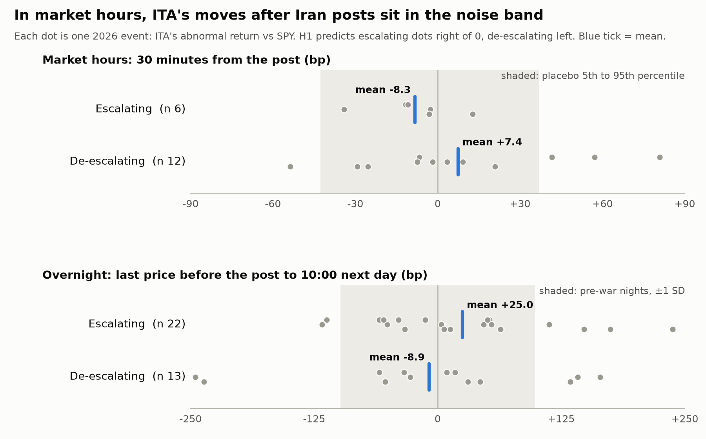

# Do Trump's Truth Social posts about Iran move US defense stocks?

[](https://github.com/syk-v1/trump-iran-defense-stocks/actions/workflows/tests.yml)


An intraday event study of **ITA** (iShares U.S. Aerospace & Defense ETF) around Donald
Trump's Truth Social posts about Iran, built on the June 2025 Twelve-Day War and tested
once, out of sample, on the 2026 Iran war.

**H1.** During the 2026 Iran war, escalatory posts about Iran were followed by positive
abnormal 30-minute returns in ITA relative to SPY, and de-escalatory posts by negative ones.

**H2.** Those abnormal returns were smaller from 8 April 2026 (the two-week ceasefire)
onwards than from 28 February to 7 April.

## Conclusion

**No. During the 2026 Iran war, Trump's posts about Iran did not move US defense
stocks relative to the market. Neither hypothesis is supported.** The verdict rule,
fixed before the test run: a hypothesis is supported only if its test passes p < 0.05
in the predicted direction.



| Hypothesis | Verdict | Deciding numbers |
|---|---|---|
| H1: escalating posts → ITA up, de-escalating → down, within 30 min | **Not supported** | 18 market-hours events; signed mean −7.7 bp (wrong direction), p = 0.93; one-sided 95% upper bound +5 bp |
| H2: smaller effect after the 8 Apr ceasefire | **Not supported** | phase 1 minus phase 2 +4.9 bp, p = 0.42 (3 vs 15 events); with no effect before the ceasefire, there was nothing to shrink |

- **A firm "no".** If the true average effect were +10 bp, a result this low would occur about 1% of the time.
  It holds with a 30-min beta (p = 0.92), with new-information posts only (p = 0.95), and with a
  placebo matched on hour of day (p = 0.92). There is no pre-post move either (p = 0.85).
- **What it can't rule out.** Effects under about 5 bp. To be caught 4 times out of 5, an
  effect would need to be about 15–19 bp.
- **One hint, not a finding.** Overnight (post outside market hours → next day's 10:00),
  escalating nights beat de-escalating ones by +34 bp, the direction H1 predicts. But p = 0.18,
  and night windows mix in other news.
- **Weakest link.** The post labels were written by an LLM (Claude) against a fixed codebook,
  and no human has checked them yet. A 200-post human check sheet can be generated.

Every decision, with what the data showed at the time, is in [`docs/decisions.md`](docs/decisions.md).
The labelling rules are in [`docs/codebook.md`](docs/codebook.md).

## Method

| Piece | Choice |
|---|---|
| Posts | [trumpstruth.org](https://www.trumpstruth.org) RSS archive, one UTC day per request (the feed caps at 500 posts); creation time to the millisecond from the post ID; image- and video-only posts dropped |
| Prices | Alpaca 1-minute bars, full consolidated tape (SIP), dividend-adjusted, ITA and SPY |
| Abnormal return | `AR = r_ITA − β·r_SPY`; β from 5-minute returns over the 30 days before each war (1-minute betas are biased down by ITA's thin trading) |
| Event window | 30 min from the post's minute, inside regular hours; the 30 min before as a reverse-causality check |
| Clustering | posts within 30 min of a cluster's first post form one event |
| Off-hours posts | separate "next open" test: last regular price before the post → 10:00 next session |
| Tagging | wide keyword net calibrated by reading every Twelve-Day War post → 427 candidates → escalating / de-escalating / neutral + new-info vs repeat, per the codebook; keyword-rule second coder (kappa 0.79 on relevance, 0.24 on direction) |
| Significance | placebo = every regular-hours minute with no post of any kind within ±30 min, per period; 10,000 resamples; H2 by permutation |
| Discipline | every setting calibrated on 2025, frozen in `src/config.py`, then run once on 2026 |

## Layout

```
src/
  config.py         episode dates, tickers, frozen settings, NYSE calendar
  collect_posts.py  download + parse posts            -> data/processed/posts.csv
  collect_prices.py 1-min ITA + SPY bars (Alpaca)     -> data/processed/prices_1min.csv
  market_hours.py   pre / regular / post / closed, DST-aware
  candidates.py     posts that might be about Iran    -> data/processed/candidates.csv
  agreement.py      second coder, Cohen's kappa, human check sheet
  event_study.py    windows, beta, clustering, placebo
  run_study.py      run one episode                   -> results/<episode>_*.csv
  robustness.py     alternative beta, hour-matched placebo, bounds, power
  figures.py        the figure above
labels/labels.csv   one label per candidate post (post id, relevance, direction, new/repeat, note)
results/            every number quoted above
docs/               decisions.md, codebook.md, figures/
tests/              51 offline pytest tests
```

## Reproduce

Needs Python 3.12+ and a free [Alpaca](https://alpaca.markets) account for the price data.

```
py -m venv .venv
.venv\Scripts\python -m pip install -r requirements.txt
copy .env.example .env                                   # paste your Alpaca market-data keys
.venv\Scripts\python -m src.collect_posts
.venv\Scripts\python -m src.collect_prices
.venv\Scripts\python -m src.candidates
.venv\Scripts\python -m src.agreement                     # --sheet writes the human check sheet
.venv\Scripts\python -m src.run_study --episode twelve_day_war
.venv\Scripts\python -m src.run_study --episode iran_war_2026
.venv\Scripts\python -m src.robustness
.venv\Scripts\python -m src.figures
.venv\Scripts\python -m pytest
```

Raw downloads and processed tables are not committed. Post text belongs to its author and
is fetched from the archive when you run the scripts.

## Limitations

- Most directional Iran posts (84%) came outside market hours, leaving 18 market-hours events.
- Labels are an LLM's; a human check is the most valuable next step.
- One ETF against one market proxy; individual contractors (LMT, NOC, RTX) are untested.

## License

MIT. See [LICENSE](LICENSE).
